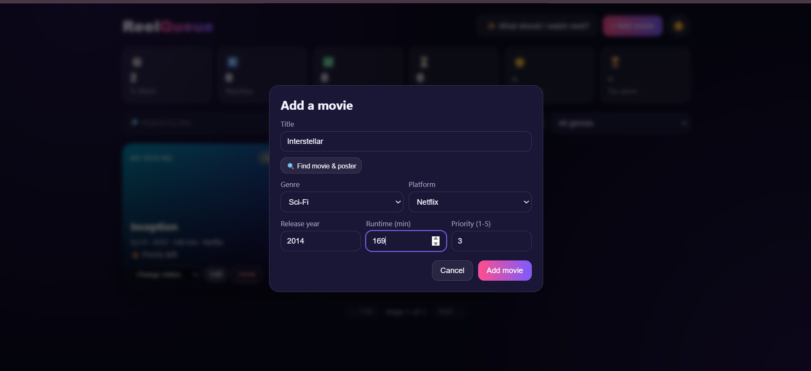

# ReelQueue - Movie Watchlist Manager

A MERN stack (MongoDB Atlas, Express, React, Node) app to plan what to watch, track what you are watching, and rate what you have finished.

## Features

- Landing page, light/dark theme, poster lookup for movie cards
- Add and edit movies with validation on frontend and backend
- Auto-generated movie code (MV-year-sequence, e.g. MV-2019-004)
- Status workflow: To Watch, Watching, Watched (Watched is final)
- Rating 1-10 required when a movie is marked Watched
- Duplicate check on title and release year (409)
- Search, filter by status and genre, pagination (6 per page)
- "What should I watch next?" picker
- Statistics dashboard (aggregation)
- Delete with confirmation (blocked while Watching)

## Project structure

```
project-root/
├── frontend/   (React + Vite)
└── backend/    (Express + Mongoose)
```

## APIs

Base URL: `/api/movies`

| Method | Endpoint | Description |
|--------|----------|-------------|
| GET | /api/movies | List movies (query: status, genre, search, page) |
| POST | /api/movies | Add a movie |
| PUT | /api/movies/:id | Edit title, genre, runtime, platform, priority |
| PATCH | /api/movies/:id/status | Change status (rating required for Watched) |
| PATCH | /api/movies/:id/rating | Edit rating (Watched movies only) |
| DELETE | /api/movies/:id | Delete a movie (not allowed while Watching) |
| GET | /api/movies/watch-next | Highest priority To Watch movie (shortest runtime on tie) |
| GET | /api/movies/stats | Statistics dashboard data |

All responses use the format `{ success, message, data }`.

## How to run

Backend:

```
cd backend
npm install
npm run dev
```

Frontend (in a second terminal):

```
cd frontend
npm install
npm run dev
```

The `.env` file in `backend` holds the MongoDB Atlas test database URI and port.

## Screenshots


