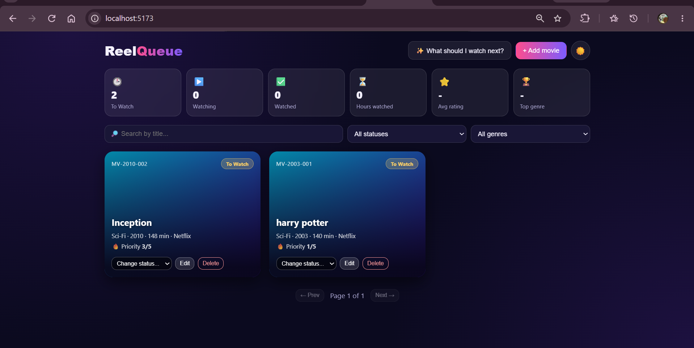

# Movie Watchlist Manager

A MERN stack app to plan what to watch, track what you are watching and rate what you have finished. Data is stored in MongoDB Atlas.

## Tech Stack
- MongoDB Atlas + Mongoose
- Express.js, Node.js
- React (Vite)

## Features
- Add, edit and delete movies with validation on frontend and backend
- Auto-generated movie code (MV-<year>-<sequence>)
- Status workflow with allowed transitions only
- Mandatory 1-10 rating when marking Watched, editable later
- Duplicate title + year check (case-insensitive, returns 409)
- Filter by status and genre, search by title, 6 movies per page
- "What should I watch next?" recommendation
- Statistics dashboard calculated with MongoDB aggregation

## Setup

git clone https://github.com/kanishka0606-c/movie-watchlist-manager
cd backend
npm install
npm run dev

In a second terminal:

cd frontend
npm install
npm run dev

Backend runs on http://localhost:5000 and frontend on http://localhost:5173. The `.env` file is included in `backend/` for evaluation (test database only).

## API List
| Method | Endpoint | Purpose |
|---|---|---|
| POST | /api/movies | Add a movie (code auto-generated) |
| GET | /api/movies?status=&genre=&search=&page= | List with filters, search and pagination |
| GET | /api/movies/watch-next | Highest priority To Watch movie (shortest runtime on ties) |
| GET | /api/movies/stats | Status counts, hours watched, average rating, top genre |
| PUT | /api/movies/:id | Edit title, genre, runtime, platform, priority |
| PATCH | /api/movies/:id/status | Change status (rating required for Watched) |
| PATCH | /api/movies/:id/rating | Edit rating of a Watched movie |
| DELETE | /api/movies/:id | Delete a movie (not allowed while Watching) |

All responses use the format `{ success, message, data }`.

## Screenshots

